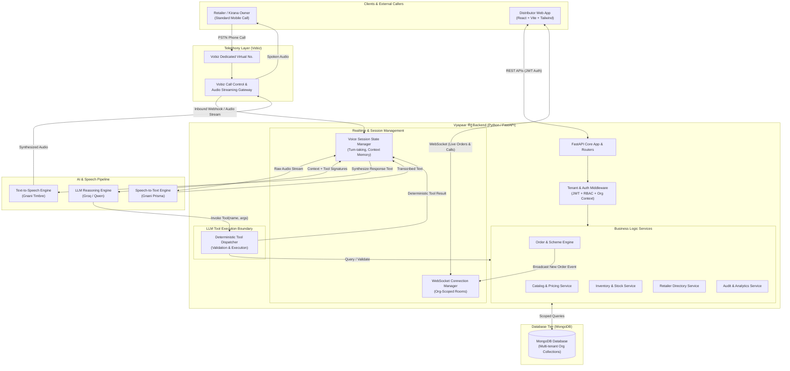
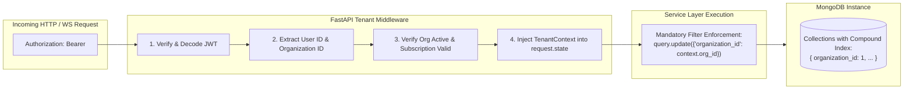
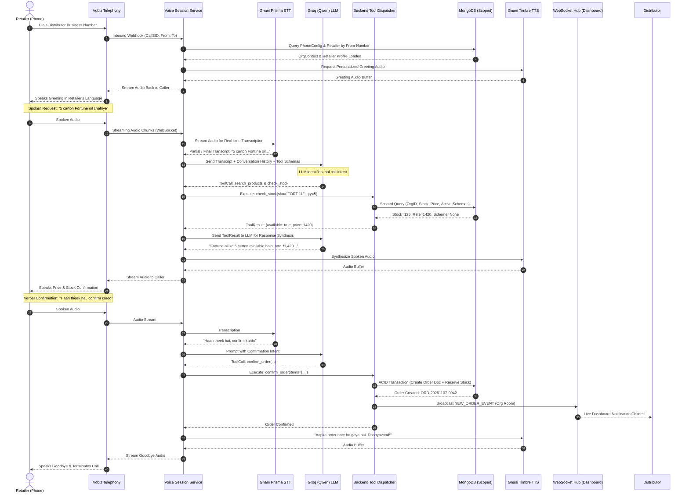

# ARCHITECTURE.md — System Architecture & Technical Specifications
# VYAPAAR सेतु (Baatcheet se business tak.)

---

## 1. HIGH-LEVEL SYSTEM ARCHITECTURE

Vyapaar सेतु is built as a modern, decoupled, multi-tenant cloud application. The frontend is a high-performance single-page application (SPA) built with React.js and Vite; the backend is a modular, asynchronous API server built with Python and FastAPI; the persistence tier is an organization-scoped MongoDB document database; and the real-time layer coordinates inbound telephony, speech processing, and dashboard synchronization via WebSockets and event webhooks.



---

## 2. PROPOSED PROJECT DIRECTORY STRUCTURE

The codebase is strictly partitioned into `frontend/`, `backend/`, and `docs/`.

```text
Vyapaar-Setu/
│
├── frontend/                               # React + Vite Client Application (JavaScript Only)
│   ├── public/                             # Static brand assets, favicons, audio chimes
│   │   ├── favicon.ico
│   │   └── sounds/order-chime.mp3
│   ├── src/
│   │   ├── app/                            # Application entry and provider composition
│   │   │   ├── App.jsx                     # Root application component & layout router
│   │   │   └── routes.jsx                  # Route definitions (public, auth, dashboard)
│   │   ├── assets/                         # SVG icons, illustrations, logo marks
│   │   │   ├── logo-mark.svg
│   │   │   └── wordmark.svg
│   │   ├── components/                     # Reusable design system primitives (shadcn/Sera/daisyUI inspired)
│   │   │   ├── ui/                         # Atomic primitives (button, input, badge, card, modal, etc.)
│   │   │   ├── feedback/                   # Toast notifications, empty states, skeleton loaders
│   │   │   └── navigation/                 # App header, sidebar, user profile menu, breadcrumbs
│   │   ├── features/                       # Domain-specific feature modules
│   │   │   ├── auth/                       # Login, registration, password recovery views & hooks
│   │   │   ├── dashboard/                  # Live order feed, quick metrics, audio monitor
│   │   │   ├── catalog/                    # Product creation, category tree, SKU management
│   │   │   ├── inventory/                  # Stock count tables, low-stock adjustments
│   │   │   ├── pricing-schemes/            # Tiered pricing, promotional rule builder
│   │   │   ├── orders/                     # Order lifecycle (accept, modify, pack, dispatch, reject)
│   │   │   ├── retailers/                  # Retailer directory, credit status, order history
│   │   │   ├── telephony/                  # Vobiz phone number setup, agent voice settings
│   │   │   └── analytics/                  # Sales charts, call duration & order conversion graphs
│   │   ├── hooks/                          # Shared custom React hooks (useAuth, useWebSocket, useDebounce)
│   │   ├── layouts/                        # Shell layouts (AuthLayout, DashboardLayout, SettingsLayout)
│   │   ├── lib/                            # Third-party wrappers, axios/fetch instance, date helpers
│   │   │   └── api-client.js               # Centralized HTTP client with interceptors
│   │   ├── styles/                         # Global Tailwind styles & font imports
│   │   │   └── index.css                   # Tailwind directives and CSS token variables
│   │   ├── utils/                          # Pure formatting utils (currency, dates, phone, units)
│   │   └── main.jsx                        # Vite React DOM entry point
│   ├── index.html                          # HTML shell with Poppins font preload
│   ├── tailwind.config.js                  # Tailwind configuration with design system tokens
│   ├── postcss.config.js                   # PostCSS plugins
│   ├── vite.config.js                      # Vite bundler configuration
│   └── package.json                        # Frontend dependencies (React, Vite, Tailwind, Lucide, Recharts)
│
├── backend/                                # Python FastAPI Backend Service
│   ├── app/
│   │   ├── api/                            # API route controllers
│   │   │   ├── v1/                         # API version 1 routers
│   │   │   │   ├── auth.py                 # Registration, login, token refresh
│   │   │   │   ├── organizations.py        # Org profile, business hours, GSTIN
│   │   │   │   ├── products.py             # Product catalog CRUD & bulk import
│   │   │   │   ├── inventory.py            # Stock adjustments & audit ledger
│   │   │   │   ├── schemes.py              # Trade promotions & discount schemes
│   │   │   │   ├── retailers.py            # Retailer directory & credit policies
│   │   │   │   ├── orders.py               # Order lifecycle management
│   │   │   │   ├── calls.py                # Call logs, recordings & transcripts
│   │   │   │   ├── webhooks_vobiz.py       # Vobiz incoming call & stream webhooks
│   │   │   │   ├── websockets.py           # Real-time WebSocket endpoint for dashboards
│   │   │   │   └── analytics.py            # Computed operational metrics & reports
│   │   │   └── router.py                   # Master v1 router aggregator
│   │   ├── core/                           # System-wide core configurations & security
│   │   │   ├── config.py                   # Pydantic BaseSettings (reads .env)
│   │   │   ├── security.py                 # Password hashing (Argon2), JWT token encode/decode
│   │   │   ├── exceptions.py               # Standardized application exception classes
│   │   │   └── logging.py                  # Structured JSON logger configuration
│   │   ├── db/                             # Database connectivity and session lifecycle
│   │   │   ├── mongodb.py                  # PyMongo Async client connection pool & lifecycle (PyMongo 4.9+ native AsyncMongoClient)
│   │   │   └── indexes.py                  # Database index creation script
│   │   ├── middleware/                     # Request lifecycle middleware
│   │   │   ├── tenant_context.py           # Organization isolation & tenant extraction
│   │   │   ├── rate_limiter.py             # API rate limiting
│   │   │   └── request_id.py               # Distributed tracing request IDs
│   │   ├── models/                         # Domain entities & database document models
│   │   │   ├── organization.py
│   │   │   ├── user.py
│   │   │   ├── product.py
│   │   │   ├── inventory.py
│   │   │   ├── scheme.py
│   │   │   ├── retailer.py
│   │   │   ├── call.py
│   │   │   └── order.py
│   │   ├── schemas/                        # Pydantic v2 validation schemas (Request/Response)
│   │   │   ├── auth.py
│   │   │   ├── product.py
│   │   │   ├── order.py
│   │   │   └── common.py                   # Standard JSON API envelope schemas
│   │   ├── services/                       # Pure business logic services (DB operations & rules)
│   │   │   ├── auth_service.py
│   │   │   ├── catalog_service.py
│   │   │   ├── inventory_service.py
│   │   │   ├── order_engine.py             # Deterministic order creation & scheme calculations
│   │   │   ├── retailer_service.py
│   │   │   └── voice_session_service.py    # Inbound call session state machine
│   │   ├── integrations/                   # External third-party API adapters
│   │   │   ├── vobiz/                      # Vobiz telephony client, webhook parser, stream bridge
│   │   │   │   ├── client.py
│   │   │   │   └── webhook_handlers.py
│   │   │   ├── speech/                     # STT/TTS engine adapters
│   │   │   │   ├── gnani_prisma_stt.py     # Gnani Prisma STT connector
│   │   │   │   └── gnani_timbre_tts.py     # Gnani Timbre TTS connector
│   │   │   └── llm/                        # LLM provider & tool execution
│   │   │       ├── groq_client.py          # Groq / Qwen conversational client
│   │   │       ├── prompt_builder.py       # Organization-specific system prompts
│   │   │       └── tools.py                # Python tool definitions callable by LLM
│   │   └── main.py                         # FastAPI application factory & lifespan events
│   ├── requirements.txt                    # Python dependencies
│   └── .env.example                        # Template for environment variables
│
├── docs/                                   # Complete System Documentation (Brain)
│   ├── PROJECT_CONTEXT.md                  # Vision, domain, personas, journey
│   ├── ARCHITECTURE.md                     # System architecture, schemas, pipelines (this file)
│   ├── DESIGN_SYSTEM.md                    # Visual guidelines, color tokens, typography, components
│   ├── DEVELOPMENT_RULES.md                # Strict engineering rules, security, testing
│   └── PHASE_ROADMAP.md                    # 11-phase development roadmap & completion criteria
│
├── .gitignore                              # Git ignore rules for node_modules, venv, .env
├── AGENTS.md                               # Root-level persistent agent operational instructions
└── README.md                               # Project entry point and repository overview
```

---

## 3. MULTI-TENANT SAAS ARCHITECTURE & DATA ISOLATION

Vyapaar सेतु employs a **Shared Database, Shared Process, Isolated Collection Scoping** architecture.



### Tenant Isolation Guarantees:
1. **Server-Side Context Binding:** `organization_id` is never accepted from client query strings or payload bodies. It is extracted strictly from the validated cryptographic JWT payload on each authenticated request.
2. **Repository-Level Filter Injection:** All data layer repository functions accept a mandatory `org_id: str` parameter. No database query can be executed without this scoping parameter.
3. **Compound Tenant Indexes:** Every collection holding tenant data is indexed with `organization_id` as the primary prefix key. This ensures high-speed query execution and prevents full-collection scans that could accidentally leak cross-tenant documents.

---

## 4. CONCEPTUAL MONGODB DATA MODEL

The database schema is designed for MongoDB, leveraging document embedding for items that are always accessed together (e.g., items within an order) and references for independent operational entities (e.g., products, retailers).

### 4.1 Collection: `organizations`
Represents the tenant boundary for each wholesale business.
```json
{
  "_id": "ObjectId",
  "name": "Sri Balaji Traders & Distributors",
  "slug": "sri-balaji-traders",
  "legal_name": "Sri Balaji Traders Private Limited",
  "gstin": "36AAACS1429B1Z0",
  "category": "FMCG_STAPLES",
  "address": {
    "line1": "Plot 42, Wholesale Mandi Road",
    "line2": "Shop No 14 & 15",
    "city": "Hyderabad",
    "state": "Telangana",
    "pincode": "500012",
    "country": "IN"
  },
  "contact": {
    "phone": "+919876543210",
    "email": "owner@sribalaji.com"
  },
  "settings": {
    "currency": "INR",
    "timezone": "Asia/Kolkata",
    "default_language": "hi-IN",
    "supported_languages": ["hi-IN", "te-IN", "en-IN"],
    "minimum_order_value": 1500.00,
    "operating_hours": {
      "monday": {"open": "08:00", "close": "20:00", "closed": false},
      "tuesday": {"open": "08:00", "close": "20:00", "closed": false},
      "wednesday": {"open": "08:00", "close": "20:00", "closed": false},
      "thursday": {"open": "08:00", "close": "20:00", "closed": false},
      "friday": {"open": "08:00", "close": "20:00", "closed": false},
      "saturday": {"open": "08:00", "close": "21:00", "closed": false},
      "sunday": {"open": "08:00", "close": "14:00", "closed": false}
    },
    "order_confirmation_policy": "VERBAL_CONFIRMATION_REQUIRED"
  },
  "is_active": true,
  "created_at": "ISODate",
  "updated_at": "ISODate"
}
```
**Indexes:** `{"slug": 1}` (unique), `{"contact.phone": 1}`, `{"gstin": 1}`.

---

### 4.2 Collection: `users`
System users who authenticate to access the distributor dashboard or platform admin.
```json
{
  "_id": "ObjectId",
  "full_name": "Ramesh Kumar Gupta",
  "email": "ramesh@sribalaji.com",
  "phone": "+919876543210",
  "password_hash": "$argon2id$v=19$m=65536,t=3,p=4$...",
  "system_role": "USER", // "PLATFORM_ADMIN" or "USER"
  "is_active": true,
  "last_login_at": "ISODate",
  "created_at": "ISODate",
  "updated_at": "ISODate"
}
```
**Indexes:** `{"email": 1}` (unique), `{"phone": 1}` (unique).

---

### 4.3 Collection: `organization_memberships`
Links users to organizations with specific RBAC permissions.
```json
{
  "_id": "ObjectId",
  "organization_id": "ObjectId",
  "user_id": "ObjectId",
  "role": "ORGANIZATION_OWNER", // "ORGANIZATION_OWNER", "ORGANIZATION_STAFF"
  "permissions": [
    "manage_catalog",
    "manage_inventory",
    "manage_orders",
    "manage_schemes",
    "view_analytics",
    "manage_telephony"
  ],
  "status": "ACTIVE",
  "created_at": "ISODate",
  "updated_at": "ISODate"
}
```
**Indexes:** `{"organization_id": 1, "user_id": 1}` (unique compound).

---

### 4.4 Collection: `products`
Wholesale product master catalog.
```json
{
  "_id": "ObjectId",
  "organization_id": "ObjectId",
  "sku": "FMCG-OIL-FORT-1L",
  "name": "Fortune Sunlite Refined Sunflower Oil",
  "brand": "Fortune",
  "category": "Edible Oils",
  "description": "Refined sunflower edible oil pouch packaging 1 Litre.",
  "base_unit": "PIECE", // PIECE, PACKET, KG, LITRE
  "packaging_unit": "CARTON", // CARTON, BORI, BOX, PETI
  "pack_multiplier": 12, // 1 Carton contains 12 pieces (1L pouches)
  "mrp": 155.00, // Maximum Retail Price per piece
  "base_wholesale_price": 1400.00, // Price per carton (12 pcs)
  "min_order_quantity": 1, // Minimum order in packaging units (1 Carton)
  "hsn_code": "1512",
  "tax_rate_percentage": 5.0,
  "is_available": true,
  "aliases": ["fortune tel", "fortune 1 litre pouch", "sunflower oil", "fortune refined"],
  "created_at": "ISODate",
  "updated_at": "ISODate"
}
```
**Indexes:**
- `{"organization_id": 1, "sku": 1}` (unique compound)
- `{"organization_id": 1, "is_available": 1}`
- `{"organization_id": 1, "name": "text", "aliases": "text"}` (compound text search)

---

### 4.5 Collection: `inventory`
Tracks stock levels, commitments, and threshold alerts for products.
```json
{
  "_id": "ObjectId",
  "organization_id": "ObjectId",
  "product_id": "ObjectId",
  "quantity_on_hand": 140, // in packaging units (cartons)
  "quantity_reserved": 15,  // committed in unfulfilled accepted orders
  "quantity_available": 125, // on_hand - reserved
  "reorder_threshold": 20,
  "allow_backorders": false,
  "last_restocked_at": "ISODate",
  "updated_at": "ISODate"
}
```
**Indexes:**
- `{"organization_id": 1, "product_id": 1}` (unique compound)
- `{"organization_id": 1, "quantity_available": 1}`

---

### 4.6 Collection: `schemes`
Dynamic trade promotions, discounts, and volume slabs.
```json
{
  "_id": "ObjectId",
  "organization_id": "ObjectId",
  "name": "Parle Monsoon Bonanza",
  "scheme_type": "BUY_X_GET_Y", // "BUY_X_GET_Y", "SLAB_DISCOUNT", "FLAT_ORDER_DISCOUNT"
  "target_product_id": "ObjectId", // Parle-G 100g
  "conditions": {
    "buy_quantity": 10, // buy 10 cartons
    "buy_unit": "CARTON"
  },
  "benefits": {
    "free_product_id": "ObjectId", // get 1 carton free
    "free_quantity": 1,
    "discount_percentage": 0.0,
    "discount_amount": 0.0
  },
  "start_date": "ISODate",
  "end_date": "ISODate",
  "is_active": true,
  "created_at": "ISODate"
}
```
**Indexes:**
- `{"organization_id": 1, "is_active": 1, "start_date": 1, "end_date": 1}`
- `{"organization_id": 1, "target_product_id": 1}`

---

### 4.7 Collection: `retailers`
Directory of retail kirana store callers associated with the distributor.
```json
{
  "_id": "ObjectId",
  "organization_id": "ObjectId",
  "store_name": "Laxmi Kirana & General Store",
  "owner_name": "Laxmi Narayana",
  "phone_numbers": ["+919848012345", "+919848098765"],
  "delivery_address": {
    "line1": "Near Hanuman Temple, Main Bazaar",
    "locality": "Begum Bazaar",
    "city": "Hyderabad",
    "state": "Telangana",
    "pincode": "500012"
  },
  "credit_terms": {
    "credit_limit": 50000.00,
    "current_balance": 12400.00,
    "payment_due_days": 7
  },
  "preferred_language": "te-IN",
  "is_verified": true,
  "created_at": "ISODate",
  "updated_at": "ISODate"
}
```
**Indexes:**
- `{"organization_id": 1, "phone_numbers": 1}` (compound multikey index for instant caller ID lookup)
- `{"organization_id": 1, "store_name": 1}`

---

### 4.8 Collection: `phone_configs`
Associates dedicated Vobiz business phone numbers with organizations.
```json
{
  "_id": "ObjectId",
  "organization_id": "ObjectId",
  "provider": "VOBIZ",
  "phone_number": "+918045678900", // E.164 formatted dedicated number
  "vobiz_account_id": "VOBIZ_ACC_109823",
  "webhook_token": "whsec_984f93284a1...",
  "voice_persona": {
    "greeting_name": "Sri Balaji Traders",
    "default_language": "hi-IN",
    "agent_gender": "FEMALE",
    "speed": 1.0,
    "fallback_forward_phone": "+919876543210" // transfer to human staff on error/request
  },
  "is_active": true,
  "created_at": "ISODate",
  "updated_at": "ISODate"
}
```
**Indexes:**
- `{"phone_number": 1}` (unique global index for inbound call routing)
- `{"organization_id": 1}` (unique compound)

---

### 4.9 Collection: `calls`
Complete audit log of every inbound phone call handled by the AI.
```json
{
  "_id": "ObjectId",
  "organization_id": "ObjectId",
  "call_sid": "vobiz_call_938102938102",
  "from_phone": "+919848012345",
  "to_phone": "+918045678900",
  "retailer_id": "ObjectId", // linked if caller is recognized
  "status": "COMPLETED", // "RINGING", "IN_PROGRESS", "COMPLETED", "FAILED", "TRANSFERRED"
  "start_time": "ISODate",
  "end_time": "ISODate",
  "duration_seconds": 184,
  "order_id": "ObjectId", // linked if order resulted from call
  "call_outcome": "ORDER_PLACED", // "ORDER_PLACED", "PRICE_ENQUIRY", "OUT_OF_STOCK", "DROPPED"
  "recording_url": "https://secure-storage.vobiz.in/recordings/rec_9381.wav",
  "created_at": "ISODate"
}
```
**Indexes:**
- `{"call_sid": 1}` (unique global index)
- `{"organization_id": 1, "created_at": -1}`
- `{"organization_id": 1, "retailer_id": 1}`

---

### 4.10 Collection: `transcripts`
Turn-by-turn conversational transcript of the voice session.
```json
{
  "_id": "ObjectId",
  "organization_id": "ObjectId",
  "call_id": "ObjectId",
  "call_sid": "vobiz_call_938102938102",
  "turns": [
    {
      "turn_number": 1,
      "speaker": "AI",
      "text": "नमस्ते! श्री बालाजी ट्रेडर्स में आपका स्वागत है। बताइए आज क्या आर्डर लिखवाना है?",
      "timestamp": "ISODate"
    },
    {
      "turn_number": 2,
      "speaker": "RETAILER",
      "text": "भैया फॉर्च्यून सनफ्लावर आयल का ५ कार्टन चाहिए। रेट क्या है?",
      "timestamp": "ISODate"
    },
    {
      "turn_number": 3,
      "speaker": "AI",
      "text": "फॉर्च्यून सनफ्लावर आयल १ लीटर के ५ कार्टन उपलब्ध हैं। रेट ₹१,४२० प्रति कार्टन है। क्या आर्डर में जोड़ दूँ?",
      "timestamp": "ISODate"
    }
  ],
  "created_at": "ISODate"
}
```
**Indexes:**
- `{"call_id": 1}` (unique)
- `{"organization_id": 1, "created_at": -1}`

---

### 4.11 Collection: `orders`
The central business document of the platform.
```json
{
  "_id": "ObjectId",
  "organization_id": "ObjectId",
  "order_number": "ORD-20261107-0042",
  "source": "AI_VOICE_CALL", // "AI_VOICE_CALL", "MANUAL_DASHBOARD"
  "call_id": "ObjectId", // null if manual
  "retailer": {
    "retailer_id": "ObjectId",
    "store_name": "Laxmi Kirana & General Store",
    "owner_name": "Laxmi Narayana",
    "phone": "+919848012345",
    "delivery_address": {
      "line1": "Near Hanuman Temple, Main Bazaar",
      "locality": "Begum Bazaar",
      "city": "Hyderabad",
      "state": "Telangana",
      "pincode": "500012"
    }
  },
  "items": [
    {
      "product_id": "ObjectId",
      "sku": "FMCG-OIL-FORT-1L",
      "product_name": "Fortune Sunlite Refined Sunflower Oil",
      "quantity": 5,
      "unit": "CARTON",
      "unit_price": 1420.00,
      "mrp": 155.00,
      "subtotal": 7100.00,
      "scheme_discount": 0.0,
      "total": 7100.00
    },
    {
      "product_id": "ObjectId",
      "sku": "FMCG-PARLE-100G",
      "product_name": "Parle-G Glucose Biscuit 100g",
      "quantity": 2,
      "unit": "BORI",
      "unit_price": 960.00,
      "mrp": 10.00,
      "subtotal": 1920.00,
      "scheme_discount": 0.0,
      "total": 1920.00
    }
  ],
  "financials": {
    "subtotal": 9020.00,
    "discount_total": 0.00,
    "tax_total": 451.00,
    "grand_total": 9471.00,
    "currency": "INR"
  },
  "status": "PENDING_ACCEPTANCE", // "PENDING_ACCEPTANCE", "ACCEPTED", "PROCESSING", "PACKED", "DISPATCHED", "DELIVERED", "REJECTED", "CANCELLED"
  "status_history": [
    {
      "status": "PENDING_ACCEPTANCE",
      "changed_by": "SYSTEM_AI_VOICE",
      "note": "Order captured from voice call vobiz_call_938102938102",
      "timestamp": "ISODate"
    }
  ],
  "idempotency_key": "idemp_call_vobiz_call_938102938102_order",
  "created_at": "ISODate",
  "updated_at": "ISODate"
}
```
**Indexes:**
- `{"organization_id": 1, "order_number": 1}` (unique compound)
- `{"idempotency_key": 1}` (unique global index to prevent duplicate order generation)
- `{"organization_id": 1, "status": 1, "created_at": -1}`
- `{"organization_id": 1, "retailer.retailer_id": 1}`

---

## 5. VOICE AI INTERACTION PIPELINE & SAFETY BOUNDARIES

The voice AI architecture connects telecommunications, streaming audio, transcription, reasoning, and speech synthesis into a low-latency pipeline.



### 5.1 Tool Execution Safety Contract
The LLM acts purely as a conversational controller and intent parser. It possesses **zero database write permissions**.

1. **Whitelisted Tool Signatures Only:**
   - `identify_caller(phone_number: str)`
   - `search_products(query: str, category: Optional[str])`
   - `check_stock(product_id: str, quantity: int, unit: str)`
   - `get_pricing_and_schemes(product_id: str, quantity: int)`
   - `calculate_order_totals(items: List[DraftItem])`
   - `confirm_and_submit_order(confirmation_token: str)`
   - `transfer_to_staff(reason: str)`
2. **Server-Side Arithmetic:** The LLM does not calculate sums, subtotals, or taxes. The Python `order_engine.py` calculates all mathematical values using deterministic standard rounding rules.
3. **Double Stock Verification:** Stock is checked when the retailer enquires, and re-verified using a transactional check at the moment of final confirmation.

---

## 6. REAL-TIME WEBSOCKET ARCHITECTURE

For distributor dashboard responsiveness, orders and live call updates must arrive within sub-second latencies without polling.

```text
[ WebSocket Communication Topology ]

Distributor Browser 1 (Owner)     Distributor Browser 2 (Staff)
        │                                  │
        └─────────────────┬────────────────┘
                          │ (WSS Connection: /api/v1/ws/{org_id})
                          ▼
            FastAPI ConnectionManager
            ┌──────────────────────────────────────────────┐
            │ Active Connections Map:                      │
            │  - org_672... : [ws_conn_1, ws_conn_2]       │
            │  - org_891... : [ws_conn_3]                  │
            └──────────────────────────────────────────────┘
                          ▲
                          │ Broadcast Event: "NEW_ORDER", "CALL_RINGING"
                          │
            Order Engine / Voice Session Service
```

### Event Payload Standards:
- `ORDER_CREATED`: Sends full order card data with audible chime trigger.
- `ORDER_STATUS_UPDATED`: Updates status pills on active order queues.
- `CALL_STATUS_CHANGED`: Shows live caller pulse (e.g., *"Incoming call from Laxmi Kirana"*).
- `STOCK_ALERT`: Emits warning when stock drops below threshold.

---

## 7. SECURITY & COMPLIANCE ARCHITECTURE

1. **Authentication:** Stateless JSON Web Tokens (JWT) signed with HMAC-SHA256 or RS256. Passwords hashed using `Argon2id` (memory-hard, resistant to GPU attacks).
2. **CORS Security:** Restricted to verified distributor dashboard domains in production; wildcards strictly forbidden.
3. **Rate Limiting:** IP-based and token-based rate limiting on public and auth endpoints (`/auth/login`, `/webhooks/*`).
4. **Idempotency Keys:** All order creation and webhook ingestion endpoints require or compute an `idempotency_key` based on `call_sid` and event sequence to prevent double billing or duplicate orders during network retries.
5. **PII and Voice Privacy:** Call recordings and audio transcripts represent confidential business trade data. Audio URLs must use short-lived pre-signed URLs; transcripts are encrypted at rest and accessible only to verified Organization Owners.

---

## 8. TELEPHONY & AUDIO STREAMING SPECIFICATION (PHASE 4 & 4.1 HARDENED)

The Vobiz telephony integration layer acts as the real-time bridge between India's telecommunications PSTN network and the Vyapaar सेतु voice processing infrastructure.

### 8.1 Inbound Webhook & Cryptographic Verification
1. **Canonical HMAC-SHA256 Verification (Vobiz V3 & V2):**
   - Inbound webhook requests (`POST /api/v1/webhooks/vobiz/inbound-call` and `/api/v1/webhooks/vobiz/call-status`) are cryptographically verified using `X-Vobiz-Signature-V3` / `X-Vobiz-Signature-V3-Nonce` or legacy `X-Vobiz-Signature-V2` / `X-Vobiz-Signature-V2-Nonce`.
   - V3 signature construct: `Base64(HMAC_SHA256(key=authToken, data=canonicalBaseURL + "." + nonce))`.
   - V2 signature construct: `Base64(HMAC_SHA256(key=authToken, data=canonicalBaseURL + nonce))`.
   - Replay attack guard: Each nonce is validated for uniqueness within a 5-minute sliding TTL cache. Reused nonces fail closed with HTTP 401.
2. **Direct-Child VobizXML Generation:**
   - In response to an incoming call, the backend produces direct-child VobizXML:
     ```xml
     <Response>
       <Stream bidirectional="true" keepCallAlive="true">wss://api.example.com/api/v1/webhooks/vobiz/stream</Stream>
     </Response>
     ```
   - `<Connect>` wrappers are strictly excluded in accordance with the official Vobiz Voice API specification.

### 8.2 WebSocket Streaming Protocol & Frame Parsing
1. **Nested Start Frame Compatibility:**
   - The stream session initializes on receipt of an official nested start frame:
     ```json
     {
       "event": "start",
       "start": {
         "callId": "CALL_ID",
         "streamId": "STREAM_ID",
         "mediaFormat": {
           "encoding": "audio/x-l16",
           "sampleRate": 16000
         }
       }
     }
     ```
   - The parser inspects `data["start"]` first, falling back to top-level attributes only when nested keys are omitted.
2. **Multi-Codec Audio Decoder:**
   - Supports dynamically negotiated `mediaFormat`:
     - `audio/x-l16` @ 16,000 Hz: 32,000 bytes/sec (16-bit mono).
     - `audio/x-l16` @ 8,000 Hz: 16,000 bytes/sec (16-bit mono).
     - `audio/x-mulaw` @ 8,000 Hz: 8,000 bytes/sec (8-bit mono).
   - Audio chunks in `media` events (`{"event": "media", "media": {"payload": "<Base64>"}}`) are decoded and duration is computed dynamically based on the negotiated sample rate and byte width.
3. **Definitive Carrier Termination:**
   - The WebSocket connection closing constitutes definitive carrier hangup. Stream cleanup does not depend on an optional JSON `stop` frame.
4. **Barge-In Control Primitives:**
   - Pre-configured control frames for Phase 5 interruption handling:
     - Outbound checkpoint: `{"event": "checkpoint", "name": "<NAME>"}`.
     - Outbound audio flush: `{"event": "clearAudio"}`.
     - Inbound tracking: `playedStream` and `clearedAudio` frame handling.

### 8.3 State Machine Monotonicity
1. **Terminal State Immutability:**
   - Call status follows a strict monotonic lifecycle: `INITIATED` -> `RINGING` -> `IN_PROGRESS` -> `COMPLETED` / `FAILED` / `BUSY` / `REJECTED` / `NO_ANSWER`.
   - Terminal states cannot be regressed by delayed, retransmitted, or out-of-order webhook callbacks.
   - Updates are executed with atomic MongoDB query filters: `{"call_status": {"$nin": ["COMPLETED", "FAILED", "BUSY", "REJECTED", "NO_ANSWER", "CANCELLED"]}}`.
   - Durations are updated monotonically using `$max` so smaller out-of-order duration updates cannot shrink recorded call times.

